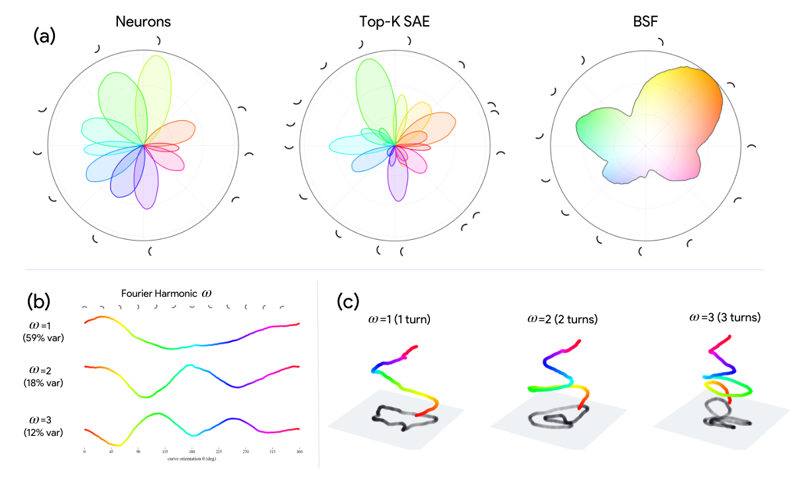
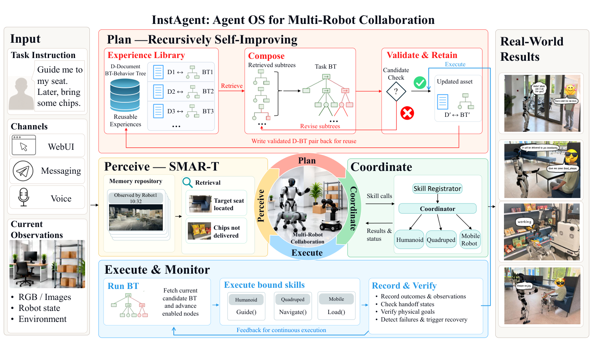

# Geometry and recovery in robot teams

Prepared 2026-11-11. Scope: simulation and a laptop, with cloud inference only if needed. This document separates author-reported findings, one offline calculation on published data, and proposed experiments. No model inference, training, robot rollout, or new experiment was run for this review.

## What the sources support

**Borrowed Geometry.** Frozen pretrained Gemma layers, connected to trained task interfaces, support offline control tasks. On cube task1 the paper reports 60.22% ± 45.87 success across three training seeds for L26, versus 0.89% for random-initialized Gemma; the published GCIQL reference is 74%. This supports transfer under the studied interface and training setup. The large seed spread and single-task scope matter. It does not test agent teams or autonomous improvement. [Paper, pp. 4–5](https://www.alphaxiv.org/pdf/2605.00333v2?page=4).

The robot connection is concrete: OGBench manipulation uses a UR5e arm and Robotiq gripper; “cube-double” means two cubes. Abay's selected task1 is single pick-and-place. [Environment](https://github.com/seohongpark/ogbench/blob/master/ogbench/manipspace/envs/manipspace_env.py), [cube task definitions](https://github.com/seohongpark/ogbench/blob/master/ogbench/manipspace/envs/cube_env.py). Multiple arms would be an extension.

**The checkpoint study.** A fixed coordinate tracks parameter identity, not a guaranteed semantic identity. The lithium viewer independently selects top contexts at each checkpoint; the onset study already follows fixed final-selected token positions. Its final-selection rule can omit transient features. The November weight study tests relative update magnitude; its own read explicitly leaves task-direction projections unresolved. Importantly, the pipeline already saves adjacent-checkpoint dot products and norms, and public examples already contain weight cosine sequences. Simply calculating those cosines is not a new methodological contribution. [Viewer extraction](https://github.com/abaybektursun/already-clean-audit/blob/de979b861f26a4235e38d0a605952d8d94d6a8e9/studies/already-clean/walkthrough/neuron_across_training/extract.py), [terms and onset](https://abaybektursun.github.io/already-clean-audit/#words), [N1 code](https://github.com/abaybektursun/already-clean-audit/blob/de979b861f26a4235e38d0a605952d8d94d6a8e9/infra/aws_pg/jobs/n1_weights.py), [N1 interpretation](https://github.com/abaybektursun/already-clean-audit/blob/de979b861f26a4235e38d0a605952d8d94d6a8e9/studies/next/n1/READ_head.md).

The math-delta experiment is another relevant caution. Top-ranked whole-neuron subsets transferred much less improvement than a rescaled random sample of MLP delta entries. That rejects the tested localization/ranking approaches; it does not exhaust all possible small neuron subsets. Entry counts were matched, but the random-entry condition was strongly rescaled. Its success does not establish that a particular low-dimensional subspace carries the gain. The author's proposed rank test remains useful. [Methods, results and proposed rank test](https://github.com/abaybektursun/already-clean-audit/blob/de979b861f26a4235e38d0a605952d8d94d6a8e9/studies/next/20_ABSTRACT.md).

**Goodfire.** BSFs represent a concept using a block of directions, retaining internal variation. Figure 11 shows how individual curve-tuned neurons and SAE directions partition orientation, while one BSF block covers the orientation family. This motivates checking populations/subspaces when a single neuron's response changes. It does not establish that lithium follows the same mechanism, or that BSF features identify robot affordances. The paper explicitly limits the universality of its block prior. [Paper, pp. 11–12 and 15](https://www.alphaxiv.org/pdf/2606.25234?page=12), [implementation](https://github.com/goodfire-ai/block-sparse-featurizer/blob/219f121ea82d2b19200d1dac918396e6058d7eb9/bsf/grassmannian.py).



**Direct robotics precedents.** CoRE is a neural mixture of collaboration experts, executed as identical policies on different robots using local observations. Its real-arm tests include partner pauses and speed reductions. It supports studying routing and timing robustness, not generic tolerance to arbitrary agent faults. [CoRE](https://www.alphaxiv.org/pdf/2610.07752).

InstAgent is closer to the user's software-agent idea: shared spatiotemporal memory, behavior-tree coordination, and retained revisions after failures. Its evaluation freezes prepared experience libraries; its illustrative repair was triggered by human feedback. It therefore provides a concrete program-improvement precedent, with a bounded meaning of recursive self-improvement. [InstAgent, methods and evaluation](https://www.alphaxiv.org/pdf/2610.23098?page=7).



RouterVLA provides a directly relevant embeddings baseline: combine semantic nearest neighbors with historical success and a limited number of probe outcomes. Its primary matched-budget advantage is 1.64 percentage points over a semantic shortlist with six probes. This is controlled replay on held-out catalog conditions, not evidence of real-time mid-trajectory takeover or generalization to unseen task templates. [RouterVLA v2, pp. 3 and 8](https://www.alphaxiv.org/pdf/2606.27355v2?page=3).

## Offline calculation actually performed

From the published m05 visualization data, I used all four fixed examples for L10N9794+, the access/CRUD cluster. This is **not** the lithium neuron. Across the recorded onset, step 180,000 to 320,000:

- Activation-vector cosine: 0.990910.
- Centered cosine: 0.998529.
- Median activation: 0.7334 to 0.8483, an increase of 15.7%.
- Its percentile threshold: 0.8414 to 0.6683, a decrease of 20.6%.
- The export dates onset at 320,000 by its percentile rule, versus 1,000,000 by its alternative raw-ratio rule.

Interpretation: a threshold crossing can coexist with a similar response profile on these examples. This is an illustration of measurement dependence, not evidence that nothing was learned. Four final-selected examples are insufficient to establish semantic stability; the CRUD activation dominates the vectors, values are rounded, and the positive-pole export clips negative activations.

[Exact source](https://github.com/abaybektursun/already-clean-audit/blob/de979b861f26a4235e38d0a605952d8d94d6a8e9/studies/already-clean/walkthrough/m05/data.js). Reproduce locally:

```sh
python3 checkpoint_cosine_demo.py
```

[Calculation](checkpoint_cosine_demo.py), [input](checkpoint_cosine_input.json), [output](checkpoint_cosine_demo.json).

## Three checkpoint tests, in priority order

1. **CPU analysis of existing records.** Examine angular drift alongside norms for gate rows, up rows, and output columns, comparing real clusters to their matched controls over identical intervals. Check onset alignment against shifted dates. Report actual training-step intervals: the 16 checkpoints are unevenly spaced. Public example records already expose cosine sequences; a population conclusion requires the complete records and cluster-aware uncertainty. [Public examples](https://github.com/abaybektursun/already-clean-audit/blob/de979b861f26a4235e38d0a605952d8d94d6a8e9/studies/next/n1/banks/weights-03/n1/samples/raw_examples_test.jsonl).

2. **Fixed examples, local weights, and upstream inputs.** Build a panel from early, lithium-dominated, late, and held-out control contexts. Preserve token IDs, marked positions, exact 2,048-token windows, and tokenizer/revision hashes. Start with four checkpoints spanning the two transitions. Record signed activation, gate/up preactivations, layer input, output contribution, and percentile. Compare both signs and background firing. A neuron fingerprint is the vector of its activations across this fixed panel, not a scalar or a list of separately selected top tokens.

   Decompose gate/up preactivation changes into changing weights versus changing inputs. A crossed old/new input-by-weight diagnostic can distinguish these contributions; reproduce native diagonal cells first and label crossed states as potentially off-distribution. Small vector updates can be consequential when aligned with the relevant inputs. Quantify downstream effect after normalization, and validate small ablations with adequate numerical precision.

3. **Does information move or disappear?** Measure task discrimination and local neighborhood structure using the full layer on the same held-out examples. Compare direct geometry to held-out orthogonal alignment, and compare low-dimensional subspaces with rank-matched random projections. Keep alignment fitting separate from evaluation. Pair global similarity with within-concept tests: broad topic structure can conceal loss of a subtle distinction. A stable probe or subspace shows recoverable information, not causal use. Use a subsequent ablation or controlled substitution to test function. [Ordinal similarity methods and limitations of aggregate alignment](https://www.alphaxiv.org/pdf/2606.16379).

An optional alternative is the math-delta singular-value/rank test. Computing spectra is descriptive and can be done on cached matrices; establishing transfer requires evaluating rank-truncated deltas against equal-rank, equal-energy controls. It is not an immediate laptop inference test for a 7B model.

## Proposed hackathon experiment

**Question:** Can similarity to successful prior situations predict which available controller can recover after another fails?

Start with one simulated arm and two controllers with overlapping grasp/recovery capability, plus a coordinator. Give the controllers different approach/recovery strategies. An obstacle observer cannot take over grasping unless it has a grasp capability. Use existing low-level skills; let software agents make task-level choices. A second arm is a stretch goal once the measurement pipeline works.

Use the OGBench cube setting if the goal is a direct link to Abay. Its repository provides state observations, a simulator, and scripted data-generation controllers. This is a proposed choice, not a verified working local installation. A pre-existing simulator in the user's stack would take priority.

Keep shared memory structured: object ID, pose, coordinate frame, timestamp, source agent, confidence, action ownership, attempted action, observed outcome, and encoder version. Use embeddings to retrieve relevant experiences; check freshness, capability, and geometry explicitly. A similar image can require the opposite action after an object slips or a gripper closes.

For each scenario, store representations and actual recovery outcomes for each controller. Evaluate **P(backup succeeds | primary failed)** and joint failure, not only pairwise embedding cosine. Shared representations may enable transfer while shared perception or memory errors make every backup fail together.

Compare, under equal observation, action, retry and compute budgets:

- Fixed controller/static recovery.
- Nearest-neighbor cosine routing.
- Routing based on observed recovery success in similar situations.
- The same routing with timestamped shared memory versus private or stale memory.

Inject planner delay, missing private observations, and stale shared object pose separately. Distinguish controller failure from perception failure and physically impossible recovery. Use paired scenario seeds across methods. A first pilot could use 30 seeds per fault, with uncertainty reported; this is a suggested pilot size, not a power guarantee.

Primary outcome: held-out recovery success. Also record constraint violations, recovery time, unnecessary takeovers, inference calls and cost. Evaluate failures on untouched objects/poses and fault timings. Check whether apparent gains come from extra retries or more computation.

**Research contribution:** establish when geometric similarity predicts behavioral substitutability, where it fails, and whether measured recovery history improves selection. Simply adding agents, a vector database, or a neural MoE is insufficient evidence for this claim.

## The improvement loop

Keep the deployed controller and the research loop distinct:

1. A diagnostic agent proposes a routing or memory-policy change from failed development episodes.
2. An experiment agent evaluates it against the frozen baseline on paired simulator cases.
3. A critic checks budgets, regressions and uncertainty.
4. Retain a changed executable policy only after it passes; log rejected candidates too.
5. After the development cycles, freeze the selected version and evaluate once on untouched final cases.

Compare against equal-budget random or simple manual policy search. If retained changes improve held-out coordination, call it measured improvement of the coordination program. Updating temporary memory alone is adaptation. A stronger claim about improving the improvement process requires separately measuring that capability over iterations.

The November 14–15 event lists AI Scientist Swarms, Recursive Self-Improvement, an autoresearch track, and a shared-memory sponsor challenge. The most natural initial fit is AI Scientist Swarms with a robot simulation as its experimental environment; the persistent policy-update loop can support the self-improvement angle. [Event brief](https://luma.com/sht6n8du).

Suggested allocation: first establish baseline behavior and fault injection; next collect calibration outcomes and compare routing rules; only then add the automated improvement loop and a final held-out demonstration. Cloud compute is optional for the robotics pilot and needed only if chosen model inference cannot fit locally.

## Five questions for Abay

1. Your N1 pipeline already stores norms, dot products and cosine sequences. Can we get the full records and exact marked input windows to test task-aligned weight changes against upstream-input changes?
2. Can we track a lithium-discriminating population/subspace through its rise and decline, and test whether the information survives when L03N6372+ stops ranking lithium highly?
3. Which Borrowed Geometry policy, trained interface, exact model revision and evaluation script can you share for a small controlled robot fault experiment?
4. Would you expect representation similarity to predict successful takeover, or would shared upstream computation make expert failures correlated? What intervention would distinguish those predictions?
5. What smallest retained change would you accept as evidence of improvement—routing, memory validation, an adapter, or a weight edit—and which held-out metric and budget would falsify it?

## Verification limits and provenance

The review inspected the public November 10 source snapshot and linked papers/methods. The only new numerical analysis here is arithmetic on four published activation examples. I did not independently run or reproduce Borrowed Geometry, Goodfire, CoRE, InstAgent or RouterVLA. I did not verify the underlying private checkpoint banks or exact original execution environments. Public exported records and implementation code are evidence of the reported methods, not proof every original run executed them correctly.

The BSF result is from vision models, whereas the lithium study is language-model MLP analysis. Their connection is a proposed unit-of-analysis hypothesis. Nothing reviewed establishes that cosine similarity certifies safety, that the robot system can withstand arbitrary faults, or that it recursively improves its learning algorithm.

Original visual crops: [BSF Figure 11](bsf-curve-manifold-figure11.png), [InstAgent Figure 1](instagent-architecture-figure1.png), [extraction script](extract_followup_figures.py). Source PDFs: [BSF](https://arxiv.org/pdf/2606.25234), [InstAgent](https://arxiv.org/pdf/2610.23098).
